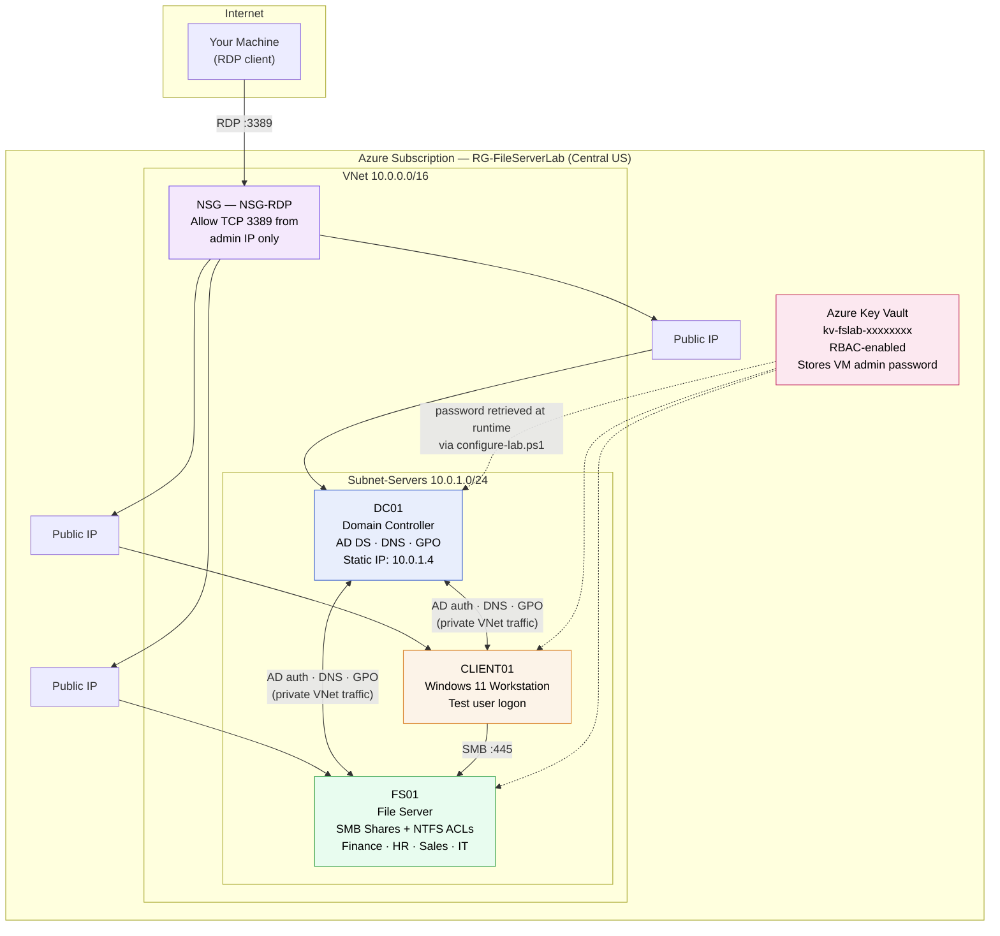

# Lab 1 — NTFS File Server Lab

**Active Directory · NTFS Permissions · SMB File Services · Group Policy · Terraform · PowerShell**

Deploys a fully automated, three-tier Windows file server environment on Azure using Terraform for infrastructure and PowerShell for configuration — demonstrating the complete real-world workflow for AD-integrated NTFS/SMB access control.

| | |
|---|---|
| **Domain** | `lab.local` — Region: Central US |
| **VMs** | `DC01` (Domain Controller) · `FS01` (File Server) · `CLIENT01` (Windows 11 Workstation) |
| **Deploy time** | 10–15 min (Terraform) + 15–20 min (`configure-lab.ps1`) |
| **Est. cost** | ~$0.15–$0.25/hr while all three VMs are running |
| **Tooling** | Terraform, Azure CLI, PowerShell, Azure Key Vault |
| **Part of** | 3-lab series — see [Lab Series](#lab-series) below |

This repo is self-contained. Every Terraform and PowerShell file needed is included — no external downloads beyond Terraform and the Azure CLI.

---

## Table of Contents

- [Lab Series](#lab-series)
- [What This Lab Demonstrates](#what-this-lab-demonstrates)
- [Skills Exercised](#skills-exercised)
- [Architecture](#architecture)
- [Repository Structure](#repository-structure)
- [Prerequisites](#prerequisites)
- [Deployment Guide](#deployment-guide)
- [Verification](#verification)
- [Pause or Tear Down](#pause-or-tear-down)
- [Troubleshooting](#troubleshooting)

---

## Lab Series

This is Lab 1 of a 3-part Azure infrastructure series. Understanding the relationship between labs matters — it explains design decisions around remote state, resource group naming, and VM names referenced downstream.

| Lab | Deploys | Relationship |
|---|---|---|
| **Lab 1 — NTFS File Server** *(this repo)* | `DC01`, `FS01`, `CLIENT01`, VNet, NSG, Key Vault in `RG-FileServerLab` | Standalone — builds all infrastructure from scratch |
| **Lab 2 — Azure RBAC** | 3 role assignments on `FS01` only, no new VMs | Depends on Lab 1 — reads Lab 1 resources via data sources, reuses Lab 1's storage account |
| **AUM Lab — Azure Update Manager** | `DC01`, `WS01`, `WS02`, VNet, Key Vault in `rg-aumlab` | Standalone — fully independent |

> **Moving on to Lab 2?** Stop the VMs instead of destroying — Lab 2 requires `FS01` to already exist, and stopped VMs incur no compute charges. See [Pause or Tear Down](#pause-or-tear-down).

---

## What This Lab Demonstrates

**The business problem:** every organization running Windows infrastructure needs to control who can access what data — Finance data readable only by Finance, HR files invisible to Sales, IT with administrative access everywhere. The solution modeled here — AD-integrated Windows file servers with NTFS permissions — remains the backbone of file access control in production environments today, including hybrid cloud deployments.

This lab walks through the complete workflow a systems administrator follows to build that solution from scratch using Infrastructure as Code.

**The test scenario:** the five AD test users represent a realistic org chart, used to validate the permission model end-to-end:

| User | Role | Expected Access |
|---|---|---|
| Sarah Jones, Mike Brown | Finance | Read/write on Finance |
| Lisa White | HR | Read/write on HR, read-only on Finance (cross-dept reporting) |
| John Smith | IT | Full control everywhere |
| Tom Davis | Sales | No access to Finance or HR |

---

## Skills Exercised

| Skill | Real-world relevance |
|---|---|
| Deploy Active Directory with Terraform | Production AD is provisioned as code to avoid manual configuration drift across environments |
| Create OUs and security groups | OUs scope Group Policy; groups let you manage hundreds of users by changing one membership instead of editing every ACL |
| Configure NTFS permissions | The actual enforcement layer on Windows file systems — inheritance and `icacls` are core sysadmin knowledge |
| Create and secure SMB shares | Every shared drive in a corporate environment uses SMB; share-level vs. NTFS-level permission interaction is a common interview topic |
| Deploy infrastructure with Terraform | IaC makes environments reproducible, version-controlled, and auditable |
| Store secrets in Azure Key Vault | Hard-coded passwords are a security failure; Key Vault is the correct pattern — retrieved at runtime, never written to disk |
| Automate with `az vm run-command` | Production Azure environments often block direct RDP/WinRM; the VM agent channel is how real automation reaches locked-down VMs |

---

## Architecture



**How it works:** `DC01` runs Active Directory, DNS, and Group Policy. `FS01` hosts four SMB shares with NTFS permissions enforced per security group. `CLIENT01` is the Windows 11 workstation where test users log in to exercise the full permission chain. All three VMs sit on one Azure VNet/subnet, reachable from your machine only via RDP through an NSG scoped to your specific public IP — all AD, DNS, and SMB traffic between the VMs stays on the private network at no data-transfer cost.

### Why Each Component Exists

| Component | Purpose |
|---|---|
| Resource Group (`RG-FileServerLab`) | Single container so `az group delete` cleans up everything; Lab 2 references this name directly |
| VNet (`10.0.0.0/16`) | Private network — VMs communicate over private IPs with no internet hop |
| Subnet (`10.0.1.0/24`) | 251 usable addresses for the three VMs |
| NSG — Allow RDP from admin IP only | Restricts inbound 3389 to one IP; all other inbound traffic implicitly denied |
| Static IP on DC01 (`10.0.1.4`) | FS01/CLIENT01 point DNS here to resolve `lab.local` — must never change across restarts |
| Public IPs on all VMs | Enables RDP verification from your local machine |
| Azure Key Vault (RBAC model) | Encrypted secret storage — the admin password never touches a file, CLI arg, or terminal history |
| `random_id` suffix on Key Vault name | Guarantees global uniqueness across all of Azure |
| `time_sleep` resources in `main.tf` | Absorbs Azure control-plane replication delay after VNet/NSG creation |
| CustomScriptExtension on CLIENT01 | Enables RDP at the OS level — Windows 11 ships with it disabled |
| `az vm run-command` in `configure-lab.ps1` | Executes configuration scripts through the Azure VM agent, bypassing the NSG's port restrictions entirely |

---

## Repository Structure

```
ntfs-lab-terraform/
├── backend.tf                             # Remote state — Azure Blob Storage
├── versions.tf                            # Provider version pins
├── variables.tf                           # Input variables (admin_password marked sensitive)
├── main.tf                                # VMs, VNet, NSG, NICs, public IPs
├── keyvault.tf                            # Key Vault + secret + RBAC assignment
├── outputs.tf                             # IPs and Key Vault name
├── terraform.tfvars.example               # Safe template — commit this
├── terraform.tfvars                       # Real values — DO NOT commit
├── .gitignore
├── configure-lab.ps1                      # Orchestrator — the only script run manually
└── scripts/
    ├── 00-promote-dc.ps1                  # DC01: AD DS install + forest promotion
    ├── 01-create-ad-users-groups.ps1      # DC01: OUs, groups, test users
    ├── 02-configure-shares-and-permissions.ps1  # FS01: SMB shares + NTFS ACLs
    ├── 03-configure-rdp-gpo.ps1           # DC01: RDP Group Policy Object
    ├── 04-domain-join.ps1                 # FS01 & CLIENT01: domain join
    ├── 05-verify-ad.ps1                   # DC01: automated PASS/FAIL AD check
    ├── 05-verify-shares.ps1               # FS01: automated PASS/FAIL permissions check
    └── 06-add-rdp-users.ps1               # CLIENT01: adds Domain Users to RDP group
```

---

## Prerequisites

```bash
terraform -version   # >= 1.5.0
az version            # Any recent Azure CLI
powershell -version   # 5.1+ (built into Windows)

# Confirm the correct Azure subscription is active
az account show
# If wrong: az account set --subscription "<name or ID>"
```

---

## Deployment Guide

> Full file contents, inline rationale for every design decision, and copy-paste-ready commands live in [`docs/DEPLOYMENT.md`](docs/DEPLOYMENT.md). Summary below.

1. **Project setup** — create `ntfs-lab-terraform/` with a `scripts/` subfolder.
2. **Terraform files** — add `backend.tf`, `versions.tf`, `variables.tf`, `main.tf`, `keyvault.tf`, `outputs.tf`, `terraform.tfvars.example`, `.gitignore`.
3. **One-time remote state setup:**
   ```bash
   az group create --name RG-TerraformState --location "Central US"
   az storage account create --name tfstatentfslab --resource-group RG-TerraformState \
     --sku Standard_LRS --encryption-services blob
   az storage container create --name tfstate --account-name tfstatentfslab
   ```
   Then update `backend.tf` with your storage account name **before** running `terraform init`.
4. **Configure variables:**
   ```powershell
   Copy-Item terraform.tfvars.example terraform.tfvars
   # Set rdp_source to your IP (whatismyip.com) in terraform.tfvars
   $env:TF_VAR_admin_password = "YourStrongPassword!"
   ```
5. **Deploy infrastructure:**
   ```bash
   az login
   terraform init
   terraform plan     # expect 12–15 resources, including 3 VMs
   terraform apply     # ~10-15 minutes
   terraform output key_vault_name   # copy this for the next step
   ```
6. **Add the PowerShell scripts** listed in [Repository Structure](#repository-structure) to `scripts/`.
7. **Run the fully unattended configuration:**
   ```powershell
   .\configure-lab.ps1 -KeyVaultName "kv-fslab-XXXXXXXX"
   # 15-20 minutes: promotes DC01, creates AD objects, domain-joins FS01/CLIENT01,
   # configures shares + NTFS, sets up RDP GPO, runs verification
   ```

---

## Verification

RDP into `CLIENT01` using the public IP from `terraform output`. All test users share the password `P@ssw0rd123!`.

| Log in as | Share | Expected | Why |
|---|---|---|---|
| `LAB\sarah.jones` | `\\FS01\Finance` | ✅ Read/write | Member of `GRP_Finance` — Modify NTFS |
| `LAB\sarah.jones` | `\\FS01\HR` | ❌ Access Denied | Not in `GRP_HR` — no ACE on HR share |
| `LAB\lisa.white` | `\\FS01\Finance` | ✅ Read only | `GRP_HR` has Read on Finance share |
| `LAB\lisa.white` | `\\FS01\HR` | ✅ Read/write | Member of `GRP_HR` — Modify NTFS |
| `LAB\john.smith` | `\\FS01\IT` | ✅ Full Control | Member of `GRP_IT` — Full Control NTFS |
| `LAB\tom.davis` | `\\FS01\Finance` | ❌ Access Denied | `GRP_Sales` has no entry on Finance |

`configure-lab.ps1` also runs `05-verify-ad.ps1` and `05-verify-shares.ps1` automatically at the end of the run, producing a `[PASS]`/`[FAIL]` report for every AD object and NTFS ACL without needing to log into any VM.

---

## Pause or Tear Down

**Continuing to Lab 2?** Stop the VMs — do not destroy. Lab 2 requires `RG-FileServerLab` and `FS01` to still exist, and stopped VMs incur no compute charges.

```bash
# Pause
az vm stop --ids $(az vm list -g RG-FileServerLab --query "[].id" -o tsv) --no-wait

# Resume before Lab 2
az vm start --ids $(az vm list -g RG-FileServerLab --query "[].id" -o tsv) --no-wait

# Full teardown — only when completely done with the series
terraform destroy
```

---

## Troubleshooting

| Problem | Cause | Solution |
|---|---|---|
| `configure-lab.ps1` fails at Key Vault | Session expired or missing role | `az login`, retry; confirm **Key Vault Secrets User** role on the vault |
| Domain join fails — DNS not resolving | DC01 still finishing promotion | Wait 2 minutes and re-run — `configure-lab.ps1` resumes from where it stopped |
| Cannot RDP to VMs | Your public IP changed | `curl ifconfig.me`, update `rdp_source` in `terraform.tfvars`, run `terraform apply` |
| Unexpected "Access Denied" | User not in the expected group | In the RDP session run `whoami /groups` to confirm group membership |
| GPO not applying | Policy cache not refreshed | Run `gpupdate /force`, then `gpresult /r` inside the VM |
| `terraform init` fails | `backend.tf` not updated | Confirm the storage account name in `backend.tf` matches the one created in Step 3, and the `tfstate` container exists |

---

**Stack:** Terraform · Azure CLI · PowerShell · Active Directory Domain Services · Group Policy · NTFS · SMB · Azure Key Vault
